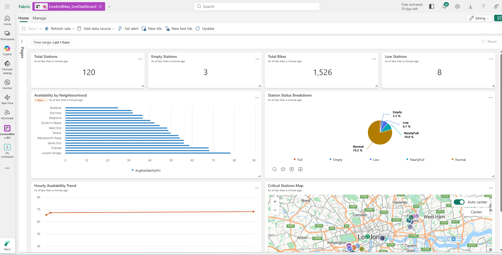

# London Bikes RTI - Microsoft Fabric Real-Time Intelligence


## Overview

This project builds a real-time data pipeline on **Microsoft Fabric** to monitor TfL Santander Cycle docking stations across London. Live station telemetry is ingested through EventStream, transformed inside an Eventhouse using a Medallion Architecture (Bronze / Silver / Gold), and surfaced via an operational dashboard and automated neighbourhood-level alerts. The goal is to support proactive bike rebalancing decisions before stations run empty.

## Business Problem

TfL operates over 750 Santander Cycle docking stations across London. A persistent operational challenge is **station rebalancing** - redistributing bikes between stations to prevent some running empty while others are full. Without real-time visibility, operations teams work from stale reports that are too slow to act on before riders are impacted.

This pipeline continuously answers three operational questions:

- Which neighbourhoods are critically low on bike availability right now?
- How is availability trending over the past few hours by zone?
- Which specific stations need urgent attention, and where are they on a map?

## Architecture

```
TfL BikePoint Feed
        |
        v
+----------------------------------+
|        Fabric EventStream         |
|  Source : Bicycles (Sample Data)  |
|  Operator: ManageFields           |
|  Destination: Eventhouse          |
+----------------+-----------------+
                 |  Streaming ingest
                 v
+----------------------------------------------------+
|            Eventhouse - LondonBikes_EH             |
|                                                    |
|   +--------------+   Update Policy                 |
|   |    BRONZE    | ----------------->              |
|   | Bikes_Bronze |  TransformBronzeToSilver()      |
|   +--------------+                                 |
|                         |                          |
|                         v                          |
|                 +---------------+                  |
|                 |    SILVER     |                  |
|                 | Bikes_Silver  |                  |
|                 +-------+-------+                  |
|                         |  Materialized Views       |
|          +--------------+--------------+           |
|          v              v              v           |
|  +--------------+ +--------------+ +----------+   |
|  | mv_Station   | | mv_Neighbour | | mv_Hourly|   |
|  | Summary      | | hoodRollup   | | Trend    |   |
|  +--------------+ +--------------+ +----------+   |
|                        GOLD                        |
+----------------------------------------------------+
                         |
          +--------------+--------------+
          v                             v
+----------------------+    +-------------------------+
|   Fabric Activator   |    |   Real-Time    |
| NeighbourhoodAvail-  |    | LondonBikes_Live|
| ability alert        |    | KPIs, Charts, Map        |
+----------------------+    +-------------------------+
```

## EventStream

**Pipeline:** `LondonBikes_Stream`

The EventStream ingests the TfL Bicycles sample feed, applies a **ManageFields** operator to select and standardise the required columns, and routes the cleaned stream directly into the Eventhouse. Business logic is kept out of the EventStream layer entirely - transformation happens in KQL.

**Fields selected by ManageFields:** `BikepointID`, `Street`, `Neighbourhood`, `Latitude`, `Longitude`, `No_Bikes`, `No_Empty_Docks`


## Eventhouse - Medallion Architecture

**Database:** `LondonBikes_EH`

The entire transformation chain (Bronze ingestion, Silver enrichment, Gold aggregation) runs natively in KQL using Update Policies and Materialized Views. No external compute is required.

### Bronze - Raw Ingestion

**Table:** `Bikes_Bronze`

Raw landing table. Data arrives from EventStream unchanged, preserving the original event timestamp and all source fields. This layer serves as the replayable source of truth.

| Column          | Type     | Description                                          |
|-----------------|----------|------------------------------------------------------|
| `BikepointID`   | string   | Station identifier (e.g. `BikePoints_460`)           |
| `Street`        | string   | Street address                                       |
| `Neighbourhood` | string   | Area grouping (e.g. Fitzrovia, Chelsea, Battersea)   |
| `Latitude`      | real     | WGS84 latitude                                       |
| `Longitude`     | real     | WGS84 longitude                                      |
| `No_Bikes`      | int      | Available bikes at time of event                     |
| `No_Empty_Docks`| int      | Empty docking spaces                                 |
| `Timestamp`     | datetime | Event timestamp from source                          |


### Silver - Enriched and Classified

**Table:** `Bikes_Silver` populated via Update Policy on `Bikes_Bronze`

Every row inserted into Bronze triggers the `TransformBronzeToSilver()` function, which writes an enriched version to Silver. Four computed columns are added:

| Column            | Logic                                                                              |
|-------------------|------------------------------------------------------------------------------------|
| `TotalDocks`      | `No_Bikes + No_Empty_Docks`                                                        |
| `AvailabilityPct` | `round(toreal(No_Bikes) / TotalDocks * 100, 1)` guarded against divide-by-zero    |
| `StationStatus`   | Five-category classification (see below)                                           |
| `IngestionTime`   | `ingestion_time()` used for latency monitoring                                     |

**StationStatus classification:**

```kql
StationStatus = case(
    No_Bikes == 0,         'Empty',
    No_Empty_Docks == 0,   'Full',
    No_Bikes <= 3,         'Low',
    No_Empty_Docks <= 3,   'NearlyFull',
                           'Normal'
)
```

Null or empty `Neighbourhood` values are replaced with `'Unidentified'` to prevent broken group-bys in downstream aggregations.


### Gold - Materialized Views

Three Materialized Views continuously pre-aggregate Silver data. Both the  and Activator query these views exclusively - no raw Silver scans at read time.


**`mv_StationSummary`** pulls the latest snapshot per station using `arg_max(Timestamp, *)` and is used by the geospatial map and per-station lookups.


**`mv_NeighbourhoodRollup`** aggregates at neighbourhood level: total stations, total bikes, empty/low/full counts, and average availability percentage. This is the view the Activator alert and the Availability by Neighbourhood chart both query.


**`mv_HourlyTrend`** bins Silver data into 1-hour buckets by neighbourhood, tracking average bike count, average availability, and empty station count over time. Used by the Hourly Availability Trend chart.


## Activator - Automated Alerts

**Object:** `LondonBikes_EH event` / **Rule:** `NeighbourhoodAvailability`

The Activator polls `mv_NeighbourhoodRollup` (Gold layer) every **5 minutes**. When any neighbourhood's average bike availability drops below **30%**, an alert fires with the neighbourhood name, current availability percentage, and number of empty stations.

```kql
mv_NeighbourhoodRollup
| where AvgAvailabilityPct < 30
| project Neighbourhood, AvgAvailabilityPct, EmptyStations
```

This gives the rebalancing team precise, actionable information - not just that something is wrong, but exactly where to send a van and how critical the situation is.


## Real-Time Dashboard

**Dashboard:** `LondonBikes_LiveDashboard` / **Source:** `LondonBikes_EH` (Gold layer) / **Auto-refresh:** Enabled

All dashboard visuals query the Gold Materialized Views directly.

| Visual                        | Source View               | Description                                            |
|-------------------------------|---------------------------|--------------------------------------------------------|
| KPI - Available Stations      | `mv_NeighbourhoodRollup`  | Count of stations in Normal / NearlyFull status        |
| KPI - Empty Stations          | `mv_NeighbourhoodRollup`  | Count of stations with zero bikes                      |
| KPI - Total Bikes             | `mv_NeighbourhoodRollup`  | Sum of available bikes across the network              |
| KPI - Low Stations            | `mv_NeighbourhoodRollup`  | Count of stations with 3 or fewer bikes                |
| Availability by Neighbourhood | `mv_NeighbourhoodRollup`  | Bar chart ranked by `AvgAvailabilityPct`               |
| Station Status Breakdown      | `mv_NeighbourhoodRollup`  | Pie chart of status distribution across the network    |
| Hourly Availability Trend     | `mv_HourlyTrend`          | Line chart of average availability over time           |
| Critical Stations Map         | `mv_StationSummary`       | Geospatial map using `Latitude` / `Longitude`          |



## KQL Analytics Queryset

**Queryset:** `LondonBikes_Analytics`

A set of analytical and operational queries for deeper investigation beyond the dashboard.

| Query                          | Description                                                                                     |
|--------------------------------|-------------------------------------------------------------------------------------------------|
| Q8 - Station volatility        | Stations with the most status changes in a 6-hour window, surfacing locations that flip frequently between Empty and Normal |
| Q9 - Ingestion latency check   | Measures `datetime_diff` between `IngestionTime` and `Timestamp` to verify pipeline freshness   |
| Q10 - Geospatial low-availability | Stations below 20% availability with coordinates, ordered by `AvailabilityPct` ascending     |


## Repository Structure

```
LondonBikes-RTI/
├── README.md
├── kql/
│   ├── 01_bronze_table.kql            - Bikes_Bronze table definition
│   ├── 02_silver_table.kql            - Bikes_Silver table definition
│   ├── 03_transformation_function.kql - TransformBronzeToSilver() function
│   ├── 04_update_policy.kql           - Update Policy (Bronze to Silver)
│   ├── 05_gold_materialized_views.kql - mv_StationSummary, mv_NeighbourhoodRollup, mv_HourlyTrend
│   └── 06_analytics_queries.kql       - Operational and analytical queries (Q1-Q10)
├── architecture/                      - Architecture diagrams
├── docs/                              - Design notes and supporting documentation
└── Screenshots/
    ├── EventStream/
    ├── EventHouse/
    ├── Activator/
    ├── Live_Dashboard/
    └── Testing/
```

## Tech Stack

| Component                        | Purpose                                                   |
|----------------------------------|-----------------------------------------------------------|
| Microsoft Fabric EventStream     | Continuous real-time data ingestion                       |
| Fabric Eventhouse (KQL Database) | Streaming storage, transformation, and aggregation        |
| KQL - Update Policy              | Automated Bronze to Silver transformation on every insert |
| KQL - Materialized Views         | Continuously pre-aggregated Gold layer                    |
| Fabric Activator                 | Rule-based alerting from Gold layer data                  |
| Fabric Real-Time Dashboard       | Live operational visualisation from Gold layer            |
| TfL Bicycles sample dataset      | Simulated TfL BikePoint station telemetry                 |
