# London Bikes — Real-Time Intelligence on Microsoft Fabric


---

## Why I built this

Anyone who's used the Santander Cycles in London knows the frustration — you walk up to a docking station and it's either completely empty or completely rammed with no free docks. TfL has hundreds of stations across the city and rebalancing them (physically moving bikes between stations via vans) is genuinely hard to do well without real-time data.

The question I wanted to answer was: **can I build something that tells an operations team, right now, which neighbourhoods are running critically low — not five minutes ago, not from a batch report, but live?**

This project is my attempt to do that using Microsoft Fabric's Real-Time Intelligence stack. It streams live BikePoint telemetry through an EventStream, stores and transforms it in an Eventhouse using a Medallion Architecture built entirely in KQL, fires automated alerts via Activator when a neighbourhood drops below 30% availability, and surfaces everything on a live dashboard.

---

## How it all fits together

```
TfL BikePoint feed
      │
      ▼
 EventStream  ──(ManageFields)──►  Eventhouse (LondonBikes_EH)
                                         │
                            ┌────────────┼────────────┐
                            ▼            ▼             ▼
                         Bronze       Silver          Gold
                       (raw data)  (Update Policy) (Materialized Views)
                                         │
                            ┌────────────┼────────────┐
                            ▼                          ▼
                        Activator             Real-Time Dashboard
                    (neighbourhood alerts)    (KPIs, charts, map)
```

No Spark, no Dataflow, no external compute. Everything lives inside the Eventhouse and runs as native KQL — which keeps latency low and the architecture simple.

---

## The EventStream

The pipeline starts with an EventStream called `LondonBikes_Stream`. The source is the Fabric Bicycles sample dataset, which simulates a live TfL BikePoint feed. In a real production setup you'd swap this for a direct connection to the TfL Unified API, but the schema and refresh pattern are the same.

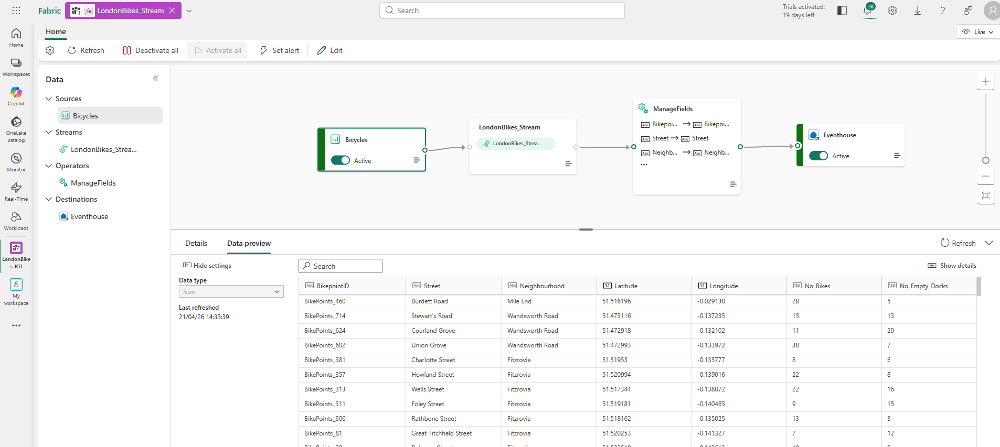

The stream topology is three nodes: a **Bicycles** source, a **ManageFields** operator in the middle, and an **Eventhouse** destination. It's deliberately kept simple — EventStream isn't the place for business logic, that happens in the KQL layer.

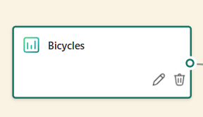

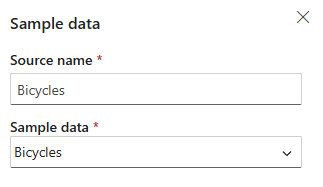

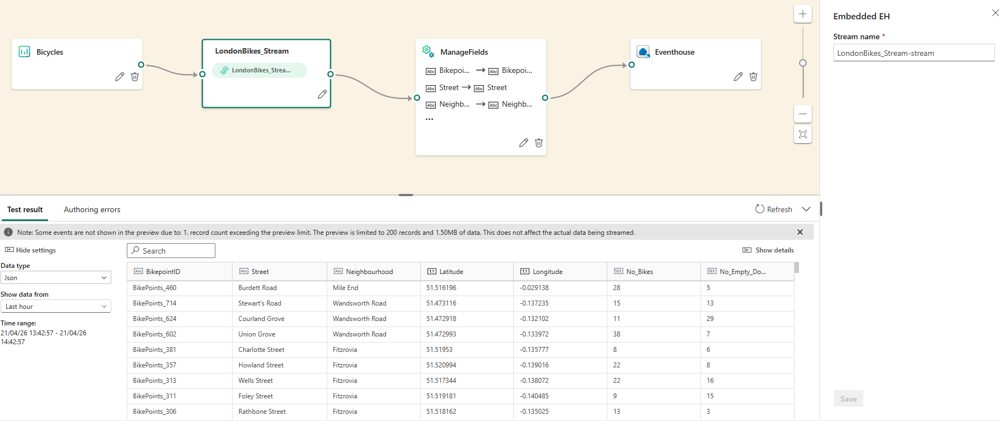

The ManageFields operator just selects and standardises the columns I care about: `BikepointID`, `Street`, `Neighbourhood`, `Latitude`, `Longitude`, `No_Bikes`, `No_Empty_Docks`. Everything else from the source gets dropped here before it even hits storage.

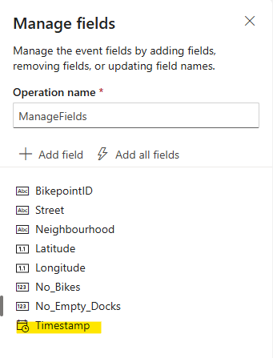

From there, the data routes straight into the Eventhouse destination — the stream is active and ingesting continuously.

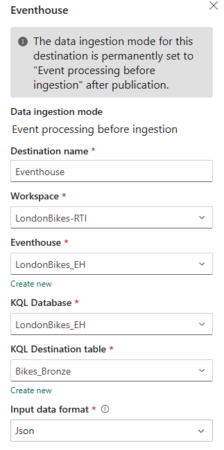

---

## Eventhouse — Medallion Architecture in KQL

The Eventhouse database is `LondonBikes_EH`, and I've organised it into a proper Bronze / Silver / Gold structure. What I like about doing this in KQL is that the whole transformation chain is declarative — you define the Update Policy and the Materialized Views once, and Eventhouse handles the rest automatically for every new row that arrives.

### Bronze — raw ingestion

`Bikes_Bronze` is the landing table. Nothing fancy here — data arrives from the EventStream exactly as-is, with timestamps and all original fields intact. The schema is flat: `BikepointID`, `Street`, `Neighbourhood`, `Latitude`, `Longitude`, `No_Bikes`, `No_Empty_Docks`, `Timestamp`.

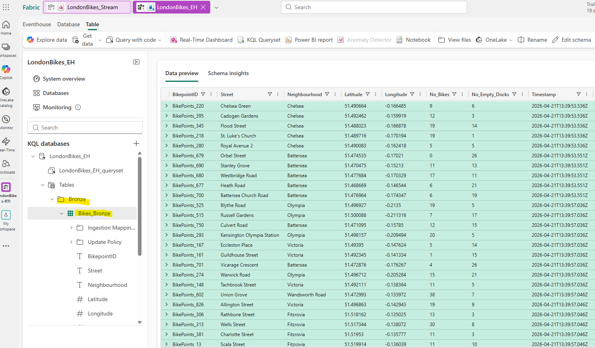

I deliberately don't transform anything at this layer. If something goes wrong downstream I can always replay from Bronze.

### Silver — enriched and classified

`Bikes_Silver` is where the interesting work happens. It's populated automatically via an **Update Policy** that fires `TransformBronzeToSilver()` on every Bronze insert.

The function does three things:

1. **Calculates TotalDocks and AvailabilityPct** — simple arithmetic (`No_Bikes + No_Empty_Docks`) and a percentage rounded to one decimal place
2. **Assigns a StationStatus** using a case statement with five categories: `Empty`, `Full`, `Low` (≤3 bikes), `NearlyFull` (≤3 empty docks), and `Normal`
3. **Cleans nulls** — any station with a missing or null `Neighbourhood` gets labelled `'Unidentified'` rather than breaking downstream group-bys

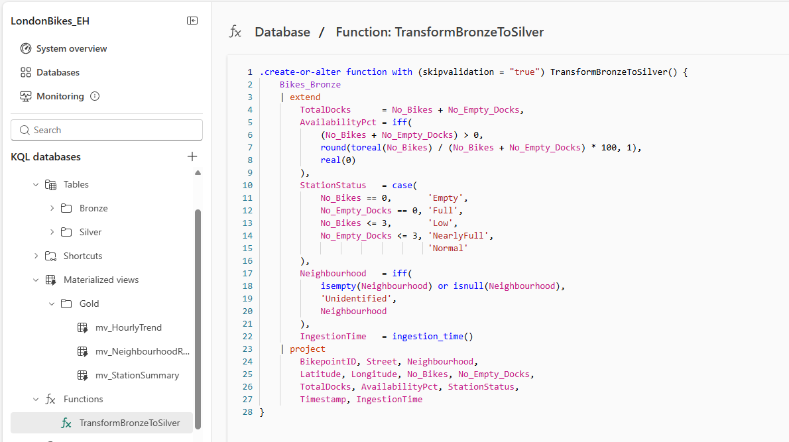

The Silver table also captures `IngestionTime` via `ingestion_time()`, which I use later to monitor pipeline latency.

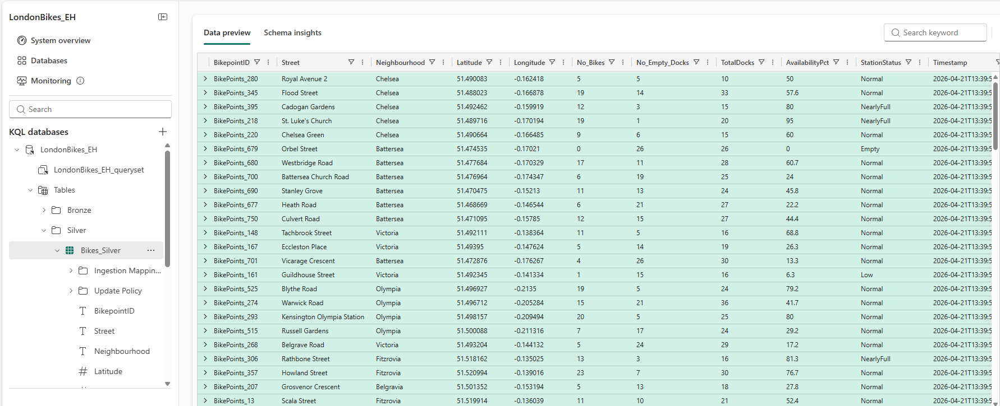

The data quality improvement is visible just by glancing at Silver vs Bronze — you can immediately see which stations are `Empty`, `NearlyFull`, etc., without writing any extra logic in the consuming query.

### Gold — Materialized Views

Rather than scanning Silver on every dashboard refresh, I pre-aggregate it into three Materialized Views sitting in the `Gold` folder.

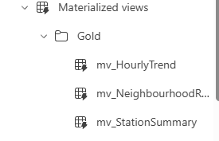

**`mv_StationSummary`** — gives you the latest reading per station using `arg_max(Timestamp, *)`. This is what the map visual queries, and it's also the source for the geospatial low-availability analysis.

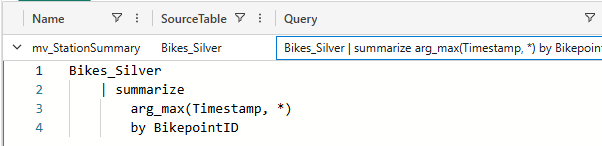

**`mv_NeighbourhoodRollup`** — aggregates everything by neighbourhood: total stations, total bikes, empty/low/full counts, and average availability percentage. This is the most-queried view in the whole project — the dashboard, the Activator, and most of the analytics queries all use it.

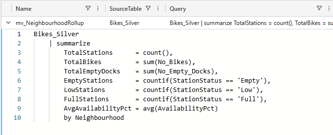

**`mv_HourlyTrend`** — buckets Silver into 1-hour bins by neighbourhood, tracking average bike count, average availability, and empty station count over time. Powers the trend chart on the dashboard.

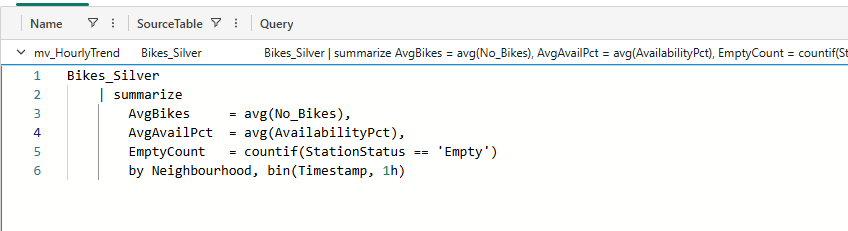

---

## Activator — automated neighbourhood alerts

The Activator object `LondonBikes_EH event` has one rule: `NeighbourhoodAvailability`. Every **5 minutes** it runs this query against the Eventhouse:

```kql
mv_NeighbourhoodRollup
| where AvgAvailabilityPct < 30
| project Neighbourhood, AvgAvailabilityPct, EmptyStations
```

If any neighbourhood has dropped below 30% average availability, an alert fires with the neighbourhood name, its current availability percentage, and how many of its stations are completely empty. That's the information a rebalancing team actually needs — not a generic "something is wrong" ping, but exactly where to send the van and how bad it is.

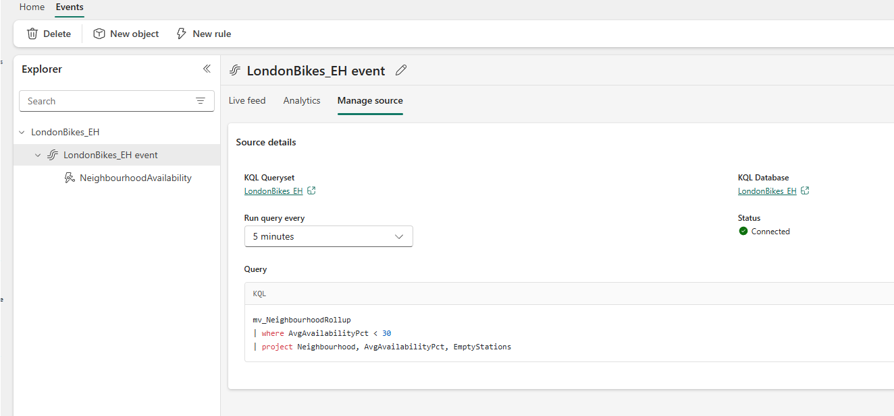

The 30% threshold is configurable. I picked it because at that point there's still time to react — below 15% things tend to cascade quickly as remaining stations empty out faster from displaced demand.

---

## Real-Time Dashboard

The `LondonBikes_LiveDashboard` auto-refreshes and connects directly to the Eventhouse. At a glance it shows the full network health.


The four KPI tiles at the top — Available Stations, Empty Stations, Total Bikes, Low Stations — give the operational summary in seconds. Below that:

- The **Availability by Neighbourhood** bar chart immediately shows which zones are under-served, sorted so the worst are visible first
- The **Station Status Breakdown** pie chart shows the proportion of the network in each state (Empty, Low, NearlyFull, Normal, Full)
- The **Hourly Availability Trend** line chart reveals recurring patterns — useful for planning proactive rebalancing before demand hits
- The **Critical Stations Map** plots low-availability stations geographically across London using the lat/long coordinates from `mv_StationSummary`

---

## KQL Analytics queryset

Beyond the dashboard, the `LondonBikes_Analytics` queryset has a set of queries I wrote for deeper investigation. A few highlights:

- **Station volatility** (Q8) — finds stations that flip between statuses most often in a 6-hour window, surfacing locations that might need structural fixes rather than just rebalancing
- **Ingestion latency check** (Q9) — compares `IngestionTime` to `Timestamp` to confirm the pipeline is staying fresh and flag any unexpected lag
- **Geospatial low-availability** (Q10) — queries `mv_StationSummary` for all stations below 20% availability and returns their coordinates, ready to export to a mapping tool

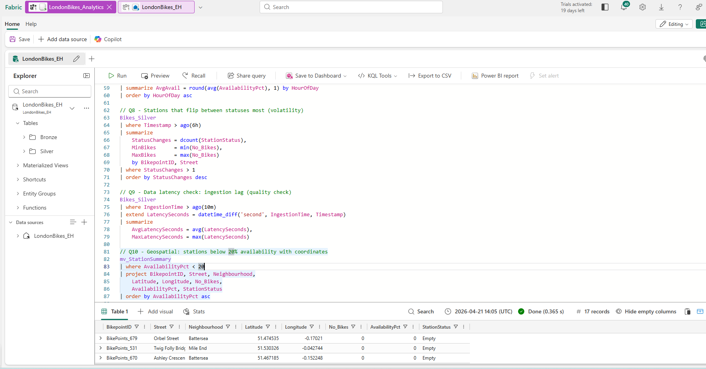

---

## Repo structure

```
LondonBikes-RTI/
├── README.md
├── kql/                  ← KQL scripts (functions, MV definitions, analytics queries)
├── architecture/         ← Architecture diagrams
├── docs/                 ← Design notes and decisions
└── Screenshots/
    ├── EventStream/
    ├── EventHouse/
    ├── Activator/
    ├── Live_Dashboard/
    └── Testing/
```

---

## Things I'd do differently / next steps

- Swap the sample data source for a live TfL API connection with proper OAuth
- Add a second Activator rule for `Full` stations (currently only alerting on low availability, but full stations cause the same rider frustration)
- Export the KQL scripts into the `kql/` folder with proper naming so the repo is fully reproducible
- Add an architecture diagram to `architecture/` — the ASCII version in this README is fine for a quick read but a proper Visio or draw.io diagram would be cleaner
- Investigate whether the `mv_HourlyTrend` could feed a predictive model for anticipating demand spikes by neighbourhood and time of day

---

## Tech used

| Thing | What for |
|---|---|
| Microsoft Fabric EventStream | Continuous ingestion from the BikePoint feed |
| Fabric Eventhouse / KQL Database | Storage, transformation, aggregation — the whole data layer |
| KQL (Kusto Query Language) | Update Policies, Materialized Views, analytics |
| Fabric Activator | Automated alerting on neighbourhood availability |
| Fabric Real-Time Dashboard | Live operational view |
| TfL Bicycles sample dataset | Simulated BikePoint telemetry |
